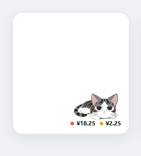

# dsh-pet-hud

[中文](#中文) | [English](#english)

DeepSeek Harness 的悬浮小宠物：显示账号余额、自上次重置以来的花费，并在高峰时段换色提醒。



---

## 中文

### 功能

- **余额 + 已消耗**：宠物下方一行，绿点余额靠左、黄点已消耗靠右。已消耗 = `重置时余额 − 当前余额`，不需要价目表。
- **高峰提醒**：北京时间工作日 9:00–12:00、14:00–18:00（法定节假日除外）余额前的圆点变红；其余时段为绿色。
- **未读会话**：别的会话跑完、你还没点进去看时，宠物切到开心；点进去或重新运行才收。当前会话跑完也会开心，直到你在主视图里开始输入（焦点进输入框或敲键）。
- **左键摸头**：开心 4 秒 + 刷新余额。
- **随机溜达**：每 6–15 分钟朝随机方向平移出去再回来。
- **可换形象**：右键切鲸鱼 / 起司猫 / 机器人；把 ≤800KB 的图片拖到宠物身上可换贴图。
- **拖动**移动位置，位置会记住。

### 安装

profile 的 `package.json` 里加依赖与 bundle，然后 `pnpm install` 并重启 DSH：

```jsonc
{
  "dependencies": { "dsh-pet-hud": "link:/path/to/dsh-pet-hud" },
  "dsh": { "profile": { "bundles": ["@deepseek-ai/dsh-base", "@deepseek-ai/dsh-web-app", "dsh-pet-hud"] } }
}
```

也可以用 git 地址：`"dsh-pet-hud": "git+https://github.com/<you>/dsh-pet-hud.git"`。

### 使用

- 左键：开心一下 + 刷新余额
- 右键：立即刷新 / 重置消耗统计 / 刷新间隔（30s、1m、5m、1h、自定义、手动）/ 换形象
- 拖动：移动位置
- 拖图片到宠物身上：换贴图（≤800KB，GIF 会动）

### 高峰时段

北京时间周一至周五 9:00–12:00、14:00–18:00 为高峰，其余时间（含周末、法定节假日、调休上班的周末）按空闲价计费。节假日表内置 2026 年国务院安排，见 `client.js` 里的 `CN_HOLIDAY_RANGES`。

### 隐私

- 不收集、不上报任何数据；代码里没有任何第三方请求。
- 余额通过 DSH 自己的账号服务读取，凭据由 DSH 管理，插件不接触也不保存。
- 本地只写 `localStorage`：`pet-hud.config.v1`（间隔、位置、形象）和 `pet-hud.baseline.v1`（消耗基线）。

### 已知限制

- 余额是拉取式的，不请求就不更新；Platform 侧扣费可能有延迟，已消耗是两次查询之间的钱包差额，不是逐笔账单。
- 未读标记是进程内状态，重启后清空。
- 起司猫形象是内嵌的透明 WebM（约 250KB），没有单独的素材文件。

### 开发

单文件客户端插件：`client.js` 用 `window.__ModuleLoader__` 注册，无构建步骤。宿主半边 `index.js` 是空实现。

### 版权

- 代码：MIT（见 [LICENSE](LICENSE)）。
- 形象与视频：为个人使用生成的同人素材，角色灵感来自《チーズスイートホーム》（起司猫/甜甜私房猫），与版权方无关；**不随 MIT 授权**。如果要公开发布或商用，请替换成自己的素材。

---

## English

### What it does

- **Balance + spend**: one row under the pet — green dot with the account balance on the left, amber dot with spend-since-reset on the right. Spend = `balance at reset − current balance`; no price table needed.
- **Peak-hour marker**: the balance dot turns red during Beijing-time weekday peak hours (09:00–12:00, 14:00–18:00, excluding Chinese public holidays), green otherwise.
- **Unread sessions**: when another session finishes and you have not opened it, the pet switches to its happy loop; it returns when you open it or it runs again. The current session finishing also makes it happy until you start typing in the main view.
- **Click** the pet for a 4-second happy reaction plus a balance refresh.
- **Random wander**: every 6–15 minutes it slides a short distance away and back.
- **Switchable looks**: whale / cat / robot from the context menu; drop an image (≤800KB) onto the pet to use it as a sprite.
- **Drag** to reposition; the position is remembered.

### Install

Add the dependency and bundle to your profile's `package.json`, then `pnpm install` and restart DSH:

```jsonc
{
  "dependencies": { "dsh-pet-hud": "link:/path/to/dsh-pet-hud" },
  "dsh": { "profile": { "bundles": ["@deepseek-ai/dsh-base", "@deepseek-ai/dsh-web-app", "dsh-pet-hud"] } }
}
```

Git installs work too: `"dsh-pet-hud": "git+https://github.com/<you>/dsh-pet-hud.git"`.

### Privacy

No telemetry, no third-party requests. The balance is read through DSH's own account service; credentials never reach the plugin. Only two localStorage keys are written: config and the spend baseline.

### License

Code is MIT. The character artwork and the embedded video are fan-made assets inspired by *Chi's Sweet Home* and are **not** covered by the MIT grant — replace them before redistributing or using commercially.
